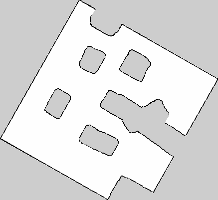

# ROS2_SIM_WS


一个面向移动机器人仿真的 ROS 2 工作区，包含 Stage 与 Gazebo Sim 仿真、SLAM Toolbox 建图等。

> 当前项目仍在开发中。主流程以 ROS 2 包为主，部分机器人描述目录来自较旧项目，可能需要根据所用 ROS 版本调整。



功能

- ✅ 使用 Stage 运行二维移动机器人仿真
- ✅ 使用 Gazebo Sim 加载机器人和仿真世界
- ✅ 使用 SLAM Toolbox 在线建图
- ✅ 使用 Nav2 Map Server 加载地图
- ✅ 使用 AMCL 进行机器人定位
- ✅ 使用 Nav2 进行路径规划、控制、行为恢复和航点导航
- ✅ 使用 RViz2 显示地图、激光雷达、机器人位姿和导航结果

## 目录结构

```text
ROS2_SIM_WS/
├── src/
│   ├── demo_stage_sim/          # Stage 仿真世界与机器人配置
│   ├── nav2/
│   │   ├── mycar_localization/  # AMCL 定位
│   │   ├── mycar_map_server/    # 地图服务器
│   │   └── mycar_navigation2/   # Nav2 配置与启动文件
│   ├── sim_gazebo/              # Gazebo Sim 世界和机器人描述
│   ├── sim_stage/               # Stage 与 stage_ros2
│   └── slam/
│       └── mycar_slam_toolbox/  # SLAM Toolbox 配置
├── map/                          # 已保存的地图
├── build/                       # colcon 编译产物，不提交到 Git
├── install/                     # colcon 安装产物，不提交到 Git
└── log/                         # colcon 日志，不提交到 Git
```

## 环境要求

- Ubuntu
- ROS 2（建议使用与当前系统匹配的桌面版）
- `colcon`
- `rosdep`
- Navigation2
- SLAM Toolbox
- RViz2
- Gazebo Sim 与 `ros_gz`（仅运行 Gazebo 示例时需要）

开始前先加载本机的 ROS 2 环境。将 `<ros-distro>` 替换成实际版本，例如 `humble` 或 `jazzy`：

```bash
source /opt/ros/<ros-distro>/setup.bash
```

## 安装依赖与编译

在工作区根目录执行：

```bash
cd ~/ROS2_SIM_WS

rosdep install --from-paths src --ignore-src -r -y
colcon build --symlink-install
source install/setup.bash
```

每次新开终端后，都需要重新加载 ROS 2 和当前工作区：

```bash
source /opt/ros/<ros-distro>/setup.bash
source ~/ROS2_SIM_WS/install/setup.bash
```

## 快速开始

### Stage 仿真

```bash
ros2 launch demo_stage_sim sim.launch.py
```

该启动文件会加载 `demo_stage_sim/world/sim.world`，并将 Stage 的 `base_scan` 话题映射为 `scan`。

### 建图与导航

下面的启动文件会依次启动 Stage、SLAM Toolbox、Nav2 和 RViz2：

```bash
ros2 launch mycar_navigation2 auto_slam.launch.py
```

如果仿真器已经单独启动，可以避免重复启动：

```bash
ros2 launch mycar_navigation2 auto_slam.launch.py start_simulator:=false
```

可以在 RViz2 中设置目标点，也可以另开终端使用键盘控制机器人探索环境：

```bash
ros2 run teleop_twist_keyboard teleop_twist_keyboard
```

### 保存地图

建图完成后，在工作区根目录保存地图：

```bash
cd ~/ROS2_SIM_WS
mkdir -p map
ros2 run nav2_map_server map_saver_cli -f map/my_map
```

该命令会生成 `map/my_map.yaml` 和对应的地图图片。

### 已有地图定位与导航

当前地图服务器默认读取工作区根目录下的 `map/my_map.yaml`。确认地图已经存在后，在工作区根目录启动：

```bash
cd ~/ROS2_SIM_WS
ros2 launch mycar_navigation2 bringup.launch.py
```

启动后，在 RViz2 中先使用 **2D Pose Estimate** 设置机器人初始位姿，再使用 **Nav2 Goal** 设置导航目标。

## Gazebo Sim 示例

加载 Gazebo 世界和机器人：

```bash
ros2 launch demo_gazebo_sim gazebo_sim_world.launch.py
```

运行带激光雷达桥接和 RViz2 的演示：

```bash
ros2 launch demo_gazebo_sim gazebo_sim_demo.launch.py
```

Gazebo 示例依赖 `ros_gz_sim` 和 `ros_gz_bridge`。不同 ROS 2 发行版对应的 Gazebo 版本不同，请安装与当前 ROS 2 发行版匹配的软件包。

## 常见问题

### 找不到功能包

确认工作区已经成功编译，并在当前终端执行：

```bash
source install/setup.bash
```

### 地图服务器提示找不到地图

确认当前终端位于工作区根目录，并检查 `map/my_map.yaml` 与地图图片是否存在。也可以先完成建图，再按照上面的步骤重新保存地图。

### 修改参数后没有生效

使用 `--symlink-install` 编译后，大多数 Python 启动文件和配置文件修改可以直接生效。如果仍未生效，请重新执行：

```bash
colcon build --symlink-install
source install/setup.bash
```

## Git 提交说明

`build/`、`install/`、`log/`、编辑器设置和缓存文件已经通过 `.gitignore` 排除，不应上传到 GitHub。提交前请在 VS Code 的“源代码管理”面板确认这些目录没有出现在待提交列表中。


